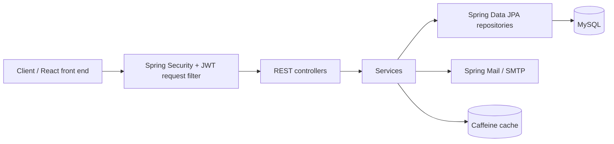

# SkyPro Backend

[](https://github.com/Neeraj95464/skypro-backend/actions/workflows/ci.yml)

A Spring Boot 3 (Java 21) REST back end for an organisation / school management system. It handles
JWT authentication, employee records, leave approvals, payroll, IT support tickets, branch presence,
job applications and service bookings, with e-mail notifications, caching and Actuator monitoring.

## Features

- **JWT authentication and role-based endpoints**: `/authenticate` issues a token; a JWT request filter
  validates the `Authorization: Bearer <token>` header. Spring Security restricts `/users`, `/admin/**`
  and `/manager/**` by role, and payroll creation uses `@PreAuthorize` (HR / ADMIN).
- **Employee profile**: personal information, contact details, education, work experience,
  banking information, job details and file uploads, each linked to the logged-in user.
- **Leave management**: employees submit leave requests; pending requests can be listed and
  approved or declined (the approver's role is read from the JWT).
- **Payroll**: HR/Admin create payroll entries; employees fetch their own payroll by year and month.
- **IT ticket workflow**: create tickets, list them, look up by id or by the caller's state, and move
  them through status transitions (`progress` then `Completed`).
- **Branch presence / attendance**: record and fetch today's branch presence; managers submit daily data.
- **Job applications**: public form endpoint with resume upload.
- **Service bookings**: create and list service bookings.
- **E-mail notifications**: welcome e-mail on registration via Spring Mail (SMTP).
- **Caching**: Spring Cache with a Caffeine cache manager for user lookups (Ehcache is also on the classpath).
- **Monitoring**: Spring Boot Actuator (health with details) under `/test/actuator`.

## Architecture



Package layout (`com.ynmio.School.Management`): `controller`, `service`, `repository`, `model`,
`config` (security, cache) and `component` (JWT filter).

## API overview

| Controller | Method | Path |
|---|---|---|
| AuthenticationController | POST | `/authenticate` |
| | POST | `/register` |
| UserController | GET | `/users` |
| | GET | `/users/{email}` |
| | POST | `/users` |
| | POST | `/users/bulk` |
| | PUT | `/users/{email}` |
| | DELETE | `/users/{email}` |
| | DELETE | `/users/delete-all` |
| EmpController | GET | `/employee` |
| | GET / PUT / DELETE | `/employee/{id}` |
| | GET | `/employee/details` |
| | POST | `/employee/leave-request` |
| | GET | `/employee/leave-requests` |
| | GET | `/employee/pending/leave-requests` |
| | POST | `/employee/leave-requests/approve/{leaveId}` |
| | POST | `/employee/leave-requests/decline/{leaveId}` |
| | POST | `/employee/personal-information` |
| | POST | `/employee/job-details` |
| | POST | `/employee/contact-details` |
| | POST | `/employee/education` |
| | POST | `/employee/work-experience` |
| | POST | `/employee/banking-information` |
| | POST | `/employee/uploads` (multipart) |
| HRController | GET | `/hr/employees` |
| ManagerController | POST | `/manager/today-data` |
| | GET | `/manager/employees` |
| PayrollController | POST | `/api/payroll` (HR / ADMIN) |
| | GET | `/api/payroll?year=&month=` |
| TicketController | POST | `/api/tickets` |
| | GET | `/api/tickets` |
| | GET | `/api/tickets/{id}` |
| | GET | `/api/tickets/state` |
| | POST | `/api/tickets/status/progress/{id}` |
| | POST | `/api/tickets/status/completed/{id}` |
| AdminController | GET | `/branch-presence/today` |
| | POST | `/branch-presence/add` |
| HomeController | POST | `/home/service-book` |
| | GET | `/home/service-books` |
| | POST | `/home/job-application` (multipart) |
| Actuator | GET | `/test/actuator/health` |

## Tech stack

Java 21, Spring Boot 3.2 (Web, Security, Data JPA, Cache, Mail, Actuator), JJWT, MySQL,
Caffeine, Lombok, Maven, Docker, GitHub Actions.

## Run locally

### With Docker Compose (app + MySQL)

```bash
cp .env.example .env      # then edit the values
docker compose up --build
```

The API is served on <http://localhost:8080>. Compose starts MySQL 8.4 with a named volume and
points the app at it (`jdbc:mysql://mysql:3306/schoolManagement`).

### With Maven

Requires Java 21 and a running MySQL with a `schoolManagement` database.

```bash
export DB_URL=jdbc:mysql://localhost:3306/schoolManagement
export DB_USERNAME=root
export DB_PASSWORD=...
export JWT_SECRET=...
export MAIL_USERNAME=...
export MAIL_PASSWORD=...
./mvnw spring-boot:run
```

## Security notes

- All credentials (database, JWT secret, SMTP account) are read from environment variables
  (`DB_URL`, `DB_USERNAME`, `DB_PASSWORD`, `JWT_SECRET`, `MAIL_USERNAME`, `MAIL_PASSWORD`).
  See `.env.example`; the real `.env` file is git-ignored.
- `JWT_SECRET` has no default, so the app will not start without it.

## Roadmap (planned)

- [ ] Integration tests with Testcontainers (MySQL), so CI can run the test suite
- [ ] OpenAPI / Swagger documentation
- [ ] Link up with the React front end: [Neeraj95464/Skypro](https://github.com/Neeraj95464/Skypro)

## Author

**Neeraj Kumar**, Java / Spring Boot developer.
[LinkedIn](https://www.linkedin.com/in/neeraj-kumar-10bbb8284/)
